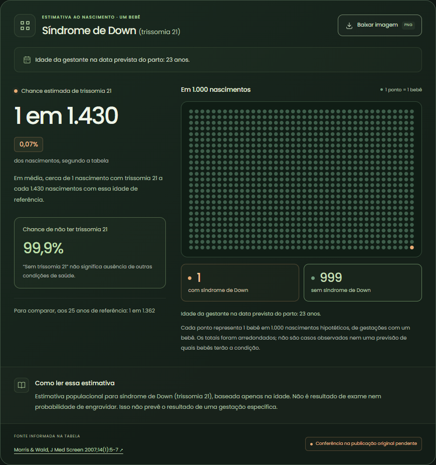

# Genética na Gestação

**Genética e gravidez em linguagem simples, com números em contexto e fontes para aprofundar a leitura.**

[](https://github.com/TwoBrainCellsBrasil/genetica-na-gestacao/actions/workflows/ci.yml)
[](LICENSE)

Código do site **Genética da Gravidez Explicada**: uma experiência educativa em português que reúne calculadora de estimativas, visualizações e explicações sobre genética na gestação. Tema escuro, navegação por teclado e layouts para celular e desktop.

> [!IMPORTANT]
> **Demonstração educativa em desenvolvimento.** A tabela de risco ainda está marcada como `conferido: false`: os valores não foram integralmente conferidos na publicação original. Os números não devem orientar decisões de saúde. O projeto não é diagnóstico, exame ou aconselhamento genético.


## O que você encontra

| Página | Conteúdo |
| --- | --- |
| `/` | Apresentação, números de exemplo e acesso aos conteúdos |
| `/calculadora` | Estimativa de trissomia 21 por idade, grade de 1.000 pontos, curva e exportação em PNG |
| `/sindromes` | Nove guias sobre alterações cromossômicas, com referências e status de revisão |
| `/mito-ou-verdade` | Cinco mitos e cinco verdades, intercalados, com filtros e fontes |
| `/painel-genetico` | O que o painel de portadores pesquisa, um exemplo de herança recessiva e limites do exame |
| `/metodologia` | Fontes, fórmulas, tabela completa, limitações e conferência dos dados |

### Uma calculadora que explica o resultado

- Informa de quem é a idade e qual data considerar: parto ou coleta do óvulo, conforme a opção selecionada.
- Permite digitar a idade ou calculá-la pelas datas, no modo sem FIV.
- Apresenta a estimativa como **1 em N**, percentual e complemento, sem tratar o resultado como diagnóstico.
- Representa 1.000 nascimentos hipotéticos e identifica o arredondamento dos pontos.
- Exporta um infográfico com contexto da idade, fonte e aviso de conferência.
- Preserva a configuração nos links e evita reaproveitar a idade ao mudar a origem do óvulo.
- Exibe a indisponibilidade de estimativas para gestações múltiplas e para idades fora da tabela.



## Executar localmente

Requisitos: **Node.js 22.23.4 ou superior**, npm e Git. Os comandos da aplicação são executados na pasta `web/`.

```bash
git clone https://github.com/TwoBrainCellsBrasil/genetica-na-gestacao.git
cd genetica-na-gestacao/web
npm ci
npm run dev -- --background
```

Abra **http://localhost:4321** ou a porta indicada no terminal.

No PowerShell, use `npm.cmd` e `npx.cmd` no lugar de `npm` e `npx` se a política de execução bloquear os arquivos `.ps1`. Não é preciso alterar a política do sistema.

```powershell
npm.cmd ci
npm.cmd run dev -- --background
```

Gerencie o servidor em segundo plano:

```bash
npm run astro -- dev status
npm run astro -- dev logs
npm run astro -- dev stop
```

## Desenvolvimento e verificações

Todos os comandos abaixo partem de `web/`.

| Comando | Finalidade |
| --- | --- |
| `npm run check` | Verificação de tipos, componentes Astro e conteúdo |
| `npm test` | Testes de cálculo, componentes, links e conteúdo com Vitest |
| `npm run test:a11y` | Acessibilidade com axe e navegação por teclado com Playwright |
| `npm run build` | Build estático de produção, sujeito à conferência dos dados |
| `npm run preview -- --port 4340` | Prévia do build em http://localhost:4340 |

Para os testes de navegador, instale o Chromium do Playwright uma vez:

```bash
npx playwright install chromium
```

A integração contínua executa verificação de tipos, testes, build de demonstração e testes de acessibilidade a cada push e pull request. Consulte o [workflow de CI](.github/workflows/ci.yml).

### Build de demonstração

O build de produção falha enquanto existir uma tabela não conferida. Para desenvolvimento, CI ou revisão visual, é possível gerar uma demonstração com aviso explícito:

```bash
PERMITIR_NAO_CONFERIDO=1 npm run build
npm run preview -- --port 4340
```

No PowerShell:

```powershell
$env:PERMITIR_NAO_CONFERIDO = "1"
npm.cmd run build
npm.cmd run preview -- --port 4340
```

Essa variável **não valida os dados** e não remove os avisos da interface. Para voltar à validação padrão no PowerShell, execute `Remove-Item Env:PERMITIR_NAO_CONFERIDO`.

## Deploy no Railway

O repositório inclui um [`Dockerfile`](Dockerfile) com build em Node.js e servidor estático Caddy, além da configuração [`railway.json`](railway.json). O container final contém os arquivos gerados em `web/dist/` e escuta na variável `PORT` fornecida pelo Railway (8080 por padrão).

1. Conecte este repositório ao serviço, usando a branch `main`.
2. Mantenha **Root Directory** na raiz do repositório (`/`), pois o build também precisa de `data/`. Usar apenas `/web` exclui esses dados.
3. Deixe **Build Command** e **Start Command** sem substituições manuais. A configuração usa o Dockerfile para construir e iniciar o site.
4. Enquanto os dados estiverem em conferência, adicione em **Variables**: `PERMITIR_NAO_CONFERIDO=1`. Isso publica uma **demonstração educativa**, mantendo os avisos da interface; não valida os dados.
5. Faça um novo deploy com o commit mais recente e gere o domínio público em **Networking**.

Sem essa variável, o build continuará bloqueado enquanto houver tabelas não conferidas. Quando a conferência integral for concluída e registrada, remova a variável.

Para testar o mesmo container localmente, a partir da raiz:

```bash
docker build --build-arg PERMITIR_NAO_CONFERIDO=1 -t genetica-na-gestacao .
docker run --rm -p 8080:8080 genetica-na-gestacao
```

Abra http://localhost:8080. As rotas são servidas como páginas estáticas independentes, incluindo URLs acessadas diretamente, como `/sindromes/down/`.

## Dados, referências e limites

Os valores ficam em [`data/risco/t21.json`](data/risco/t21.json), separados do código. O schema verifica números inteiros positivos, continuidade das idades e ordem dos valores.

O recorte atual é **trissomia 21 ao nascimento, em gestação única, para idades de referência entre 21 e 45 anos**. Não representa probabilidade de engravidar, resultado de exame ou avaliação de todas as condições de saúde. Na FIV, a idade na coleta é usada como aproximação para a mesma tabela populacional; não há um modelo específico de FIV ou incorporação de exames do embrião.

Para atualizar uma tabela:

1. Compare todos os valores com a publicação original e confira a população e o momento da estimativa.
2. Registre a referência, o link e a data da conferência.
3. Altere `conferido` para `true` somente após a conferência integral.
4. Execute as verificações e revise a explicação mostrada na interface.

Fontes indicadas no projeto incluem [MedlinePlus Genetics](https://medlineplus.gov/genetics/), [NHS England Genomics Education](https://www.genomicseducation.hee.nhs.uk/), [ACOG](https://www.acog.org/womens-health/faqs/carrier-screening), [GECKO](https://www.geneticseducation.ca/a-guide-to-understanding-prenatal-screening-tests) e as publicações citadas em cada página. A presença de uma referência não substitui a conferência da tabela nem a revisão especializada do conteúdo.

## Privacidade e acessibilidade

Os campos da calculadora são processados no navegador, sem envio para uma API e sem analytics de saúde implementados pelo projeto. Fontes tipográficas são servidas junto com a aplicação.

A idade, a opção de FIV e o número de bebês podem aparecer no fragmento do link, por exemplo `#idade=25&ovulo=doado`. Esse fragmento não é enviado na requisição HTTP, mas fica visível a quem receber o link. Datas de nascimento e parto não entram no endereço. O PNG exportado contém o contexto da idade mostrado no resultado.

A interface inclui foco visível, controles por teclado, descrições das visualizações, tabela equivalente à curva e respeito a `prefers-reduced-motion`. A animação da página inicial permite pausa; o movimento ao passar o mouse é desativado em dispositivos de toque e quando há preferência por movimento reduzido.

## Estrutura e tecnologias

```text
genetica-na-gestacao/
├── .github/workflows/       # Integração contínua
├── data/risco/              # Tabelas, fontes e status de conferência
├── docs/                    # Imagens, design e planos
└── web/
    ├── public/              # Arquivos estáticos
    ├── src/
    │   ├── components/      # Elementos compartilhados e avisos
    │   ├── content/         # Síndromes e afirmações em Markdown/MDX
    │   ├── islands/         # Calculadora e visualizações React
    │   ├── layouts/         # Estrutura das páginas
    │   ├── lib/             # Cálculos, validação, links e exportação
    │   ├── pages/           # Rotas Astro
    │   └── styles/          # Tema e estilos responsivos
    ├── tests/               # Testes unitários e de componentes
    └── e2e/                 # Testes no navegador
```

**Astro + React + TypeScript**, conteúdo em Markdown/MDX, gráficos em SVG com D3, exportação por Canvas e tipografia Poppins. O resultado do build é estático, sem backend próprio.

## Contribuir

Issues e pull requests são bem-vindos. Descreva o problema ou a melhoria, mantenha as mudanças focadas e execute `npm run check` e `npm test`. Para alterações visuais, inclua a verificação no celular e por teclado.

Alterações em conteúdo de saúde devem trazer referências verificáveis. Não remova os avisos de limite ou de conferência para fazer uma validação passar. Decisões anteriores estão documentadas em [`docs/plans/`](docs/plans/).

Próximas etapas: concluir a conferência dos dados, obter revisão especializada e preparar a publicação de uma versão hospedada. Outras condições só devem entrar na calculadora com dados e limites documentados.

## Licença

Código e documentação original sob a [licença MIT](LICENSE). Bibliotecas, a fonte Poppins (SIL Open Font License) e materiais externos citados mantêm suas próprias licenças e direitos.

Criado por [André Ruperto](https://andreruperto.dev).
